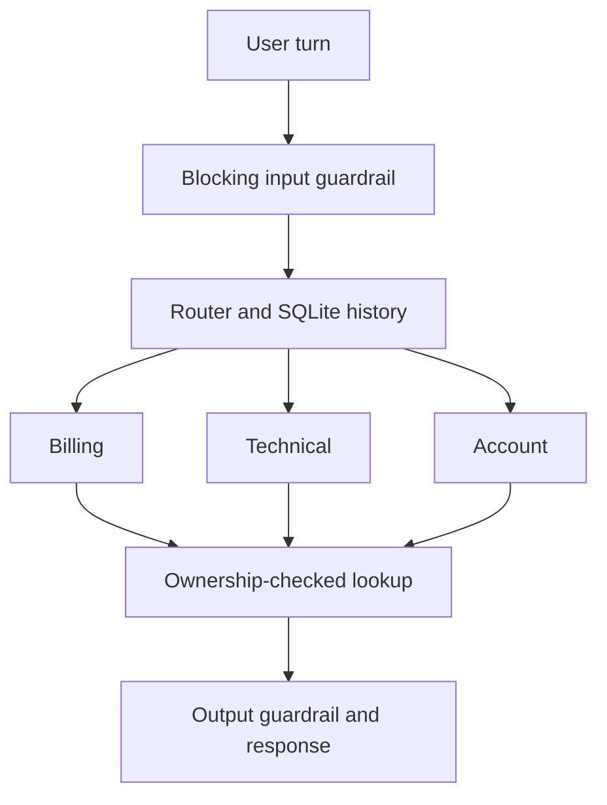

# Architecture

Each CLI turn starts at Router with persisted conversation history. Router delegates via SDK handoff to Billing, Technical or Account. Each specialist has one read-only synthetic lookup tool and an output guardrail. The blocking input guardrail runs before model inference. The tool guardrail verifies the customer ID against trusted application context; each tool also checks ownership directly.

SDK tracing surrounds execution and exports trace, agent, handoff, function and guardrail spans. A custom span records only the validated answer. Routing decisions are observable from handoff destinations, not hidden chain-of-thought. Local JSONL export avoids dependence on hosted trace authentication. Remote export is not enabled.

Provider paths: `OfflineModel` is a scripted fixture; `sharedllm` uses `OpenAIChatCompletionsModel`; `sharedllm-responses` and the separate `openai-responses` path use `OpenAIResponsesModel`. The SharedLLM Responses path is coded but has not passed a real request. All modes use the same agent graph. SQLite session IDs are prefixed by provider mode within one ignored local database. Persistent session state is not an authentication mechanism. Each CLI result includes the local SDK trace ID for matching evidence.
